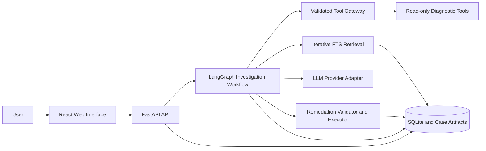
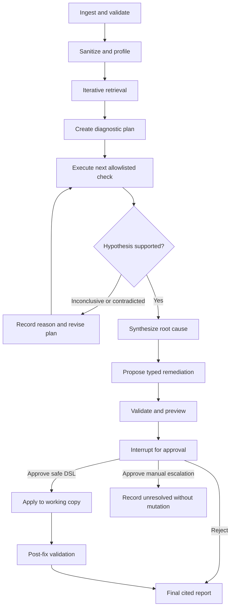

# Data Incident Investigator Architecture

## Purpose

Data Incident Investigator is a local-first agentic application for diagnosing structured-data incidents. A user creates a case, uploads a CSV or JSON dataset plus optional logs, schemas, and runbooks, and receives an evidence-backed root-cause analysis. The system may propose a constrained remediation, but it cannot modify the original artifact and cannot apply a remediation without explicit human approval.

The architecture is deliberately scoped for a solo capstone due December 10, 2026. It favors deterministic behavior, auditable control boundaries, and reproducible evaluation over broad connector support.

## Advanced Feature Claims

The project will claim exactly three advanced capabilities:

| Feature | End-to-end evidence |
|---|---|
| Multi-step planning with self-correction | The workflow creates diagnostic hypotheses, executes allowlisted checks, compares observations with expectations, and records a revised plan when evidence contradicts or fails to support the current hypothesis. |
| Agentic RAG with iterative retrieval | The workflow generates a retrieval query, searches indexed runbooks and schemas, grades the returned evidence, and refines the query when coverage or relevance is insufficient. Final conclusions cite the retrieved source chunks. |
| Human-in-the-loop approval | A persistent workflow interruption presents the proposed remediation and its preview to a non-developer UI. Application code requires an approval bound to the current source and plan hashes before it can create a remediated working copy. |

SQLite persistence, saved cases, and resumable workflow checkpoints are operational requirements. They are not presented as a fourth long-term-memory feature.

## Scope and Non-goals

The first release supports:

- CSV and JSON datasets.
- Plain-text logs.
- JSON schemas and textual runbooks.
- Single-user, local operation.
- A fixed registry of read-only diagnostic checks.
- A typed remediation language operating on a working copy.

The first release intentionally excludes:

- Arbitrary Python, shell, or SQL execution.
- Direct connections to production databases or data warehouses.
- Autonomous changes to source data.
- Multi-agent A2A, browser automation, and hybrid model routing.
- Multi-tenant authorization and horizontally scaled deployment.

## System Context



## Component Boundaries

The backend is organized by responsibility rather than framework layer alone:

```text
src/data_incident_investigator/
  api/             HTTP routes, validation, artifact downloads, error mapping
  domain/          Case, artifact, trace, citation, plan, approval models
  workflow/        Graph state, nodes, conditional edges, checkpoints
  diagnostics/     Read-only tools and typed observations
  retrieval/       Document ingestion, FTS search, evidence grading
  remediation/     Typed DSL, preview, execution, post-fix validation
  security/        Upload checks, path confinement, redaction, tool policy
  persistence/     SQLite repositories and migrations
  llm/             Provider protocol, NVIDIA/OpenAI adapters, deterministic fake
  llm/usage.py     In-memory model-call token and estimated-cost ledger
```

The frontend is a React and TypeScript application. During development it runs independently for fast iteration. For production, its static build is copied into and served by the FastAPI application so the deployment has a single process and container.

## Investigation Workflow

The graph state contains stable identifiers instead of raw filesystem paths. Important fields include:

- `case_id`, `run_id`, and `graph_version`.
- Source artifact IDs and sanitized metadata.
- Current hypothesis, diagnostic plan, observations, and revision history.
- Retrieval queries, evidence grades, and citation IDs.
- Root-cause classification and confidence.
- Proposed remediation plan, source hash, and plan hash.
- Approval ID and decision.
- Before-and-after validation results.
- Warnings and terminal status; model-call usage is recorded by the provider wrapper.



The diagnostic loop is bounded by a configurable step and revision limit. Reaching a limit produces an explicit inconclusive result instead of an unbounded loop or fabricated conclusion.

## Iterative Retrieval

Runbooks, schema descriptions, and other case documents are chunked, assigned stable source locators, and indexed using SQLite FTS5. Retrieval is implemented as a bounded subgraph:

1. Generate a query from the current hypothesis and missing evidence.
2. Search the case-scoped FTS index.
3. Grade each result for relevance and whether it supports a diagnostic action.
4. Stop when coverage is sufficient, or refine the query and repeat.
5. Preserve source and chunk identifiers for final citations.

Retrieved text is untrusted data. It can inform a hypothesis and is available again when verification compares cited evidence with diagnostic observations, but it cannot directly choose or invoke a tool. Only a typed workflow decision that passes the tool gateway can request a diagnostic operation.

## Diagnostic Tool Gateway

The initial read-only registry contains:

- Dataset profiling with bounded literal value counts.
- Null-ratio checks with explicit missing-value semantics.
- Duplicate-key checks.
- Type-conformance checks.
- Datetime parsing checks that honor the declared canonical formats.
- Log-signature extraction with bounded, redacted matching-line context.

Each tool has a Pydantic argument model, bounded row/text reads, and a case-scoped artifact resolver. Matching-log evidence is deduplicated and limited to ten lines of at most 500 characters, with credential-pattern redaction before it enters model-visible observations. Datetime diagnostics use stable format identifiers rather than model-authored parser strings. The gateway rejects unknown tools, unexpected arguments, artifacts outside the current case, and requests that exceed those bounds. The model never receives an operating-system path and never directly accesses the filesystem. Per-tool wall-clock timeouts are not implemented in this release; diagnostics operate only on locally uploaded artifacts and the workflow itself has bounded loops.

## Safe Remediation Boundary

Remediations use a discriminated union rather than free-form code. The supported operations are:

- `rename_column`
- `cast_column`
- `fill_missing`
- `drop_duplicates`
- `parse_datetime`
- `normalize_string`
- `replace_values`

A remediation plan contains the source artifact ID and SHA-256 hash, ordered typed operations, expected effects, required validations, rationale, citations, and a stable plan hash. Datetime operations accept only the canonical `rfc3339` and `MM/DD/YYYY hh:mm AM UTC` identifiers, enforce UTC output, and fail or coerce according to the declared policy; string normalization uses NFKC.

The executor enforces the following invariants:

1. Original artifacts are immutable.
2. A remediation creates a separate working copy.
3. Every operation and argument must validate against the DSL schema.
4. An approval must reference the current source hash and plan hash.
5. Approval nonces are single-use and expire.
6. A changed source or plan invalidates prior approval.
7. Operation count and bounded input-row reads are enforced in code.
8. Every proposal, decision, application, and validation emits an audit event.

Operations that could express arbitrary logic, including free-form filters and code snippets, are not part of the MVP.

## Persistence Model

SQLite runs in WAL mode and stores application metadata, workflow checkpoints, and append-only audit events. Uploaded artifacts remain in a case-scoped data directory.

Core records include:

- Cases and their lifecycle state.
- Artifacts with MIME type, size, safe storage key, and content hash.
- Documents, chunks, and the case-scoped FTS index.
- Workflow runs and graph thread identifiers.
- Diagnostic steps, observations, and revision reasons.
- Retrieval rounds, evidence grades, and citations.
- Remediation plans, approvals, and validation results.
- Graph trace events used by the UI and evaluator. Model token/cost usage is aggregated in memory for the active process and persisted in dated evaluation outputs, not in the application database.

API keys are never stored in the database or repository. They are injected at runtime through environment variables.

## HTTP Interface

The application exposes a small case-oriented API:

- Create, list, and inspect cases.
- Upload and validate case artifacts.
- Start an investigation.
- Read the current investigation state and its persisted trace events.
- Read the investigation, citations, and remediation preview.
- Approve or reject a pending remediation.
- Download a validated remediated working copy.
- Read health and readiness status.

Evaluation is executed by a local CLI that imports the production workflow. It is not exposed as a public mutation endpoint.

## User Interface

The frontend has five primary views:

1. **Case dashboard:** status, last run, case creation, and investigation navigation.
2. **Incident intake:** uploads for the dataset, log, schema, and runbooks plus expected key columns.
3. **Investigation workspace:** live plan, diagnostic observations, citations, revision events, and guardrail events.
4. **Approval review:** typed operations, before-and-after sample, impact estimate, validation plan, and approve/reject controls.
5. **Results and evaluation:** root cause, evidence, before-and-after checks, downloadable artifacts, aggregate metrics, and adversarial traces.

The UI clearly labels untrusted artifact content and visibly distinguishes model proposals from validated or executed actions.

## Safety Model

Safety is layered across the real attack surfaces:

- Extension, MIME, file-size, and row-count checks at upload.
- Safe generated storage keys and path-confinement checks.
- Credential-pattern redaction before model calls; selected retrieval excerpts and bounded derived diagnostic values remain part of the model input.
- Case-scoped retrieval and artifact access.
- Structured model outputs validated before use.
- An allowlisted, typed, read-only diagnostic gateway.
- Retrieved instructions treated as data, not control messages.
- Immutable originals and a hash-bound approval boundary.
- CSV export protections for spreadsheet formulas.
- Loop, row/text-read, upload-size, and remediation-operation limits. Provider-side rate limits are surfaced as call failures; this release does not implement an application rate limiter or per-tool wall-clock timeout.
- Structured, sanitized, append-only audit events.

Four prompt-injection attacks execute against a log file, a retrieved runbook, dataset cell content, and an uploaded schema description. The system preserves the injected text, actual trace, outcome, and mitigation evidence.

## Observability and Evaluation Hooks

The graph records structured, sanitized trace events for retrieval, diagnostics, revisions,
approval, remediation, and terminal outcomes. A provider wrapper records model call counts, input,
cached-input, and output tokens plus estimated cost. The evaluator consumes the persisted workflow
state and trace records used by the UI.

Primary quantitative metrics include root-cause accuracy, remediation success, post-fix validation rate, citation precision, evidence coverage, successful-revision rate, unsafe-action rate, latency percentiles, tokens per session, and estimated session cost.

## Deployment

Development is native-first: a Python virtual environment runs the API and a Node development server runs the UI. This avoids making Docker installation a prerequisite for early implementation.

The submission deployment is a single local container built in stages:

1. A Node stage compiles the React frontend.
2. A Python stage installs the backend and copies the compiled static assets.
3. FastAPI serves the API and frontend as one service.

The container runs as a non-root user, receives secrets only at runtime, and writes only to a mounted data directory and designated temporary directory. The mounted volume preserves SQLite checkpoints and case artifacts across container replacement.

This is documented as a justified alternative topology: the product is a purpose-built LangGraph investigation service rather than an OpenClaw-shaped agent. The single-user deployment keeps raw uploads, indexes, and case databases on the user's machine while sending only redacted excerpts and bounded derived evidence to the configured model. It provides a reproducible demo environment. A future multi-replica deployment would replace SQLite and local artifacts with Postgres and object storage.

## Architectural Rationale

The design makes each capstone claim inspectable in code and visible in the demo. The planning loop records why a plan changed, retrieval records why another search was needed, and the approval boundary is an enforceable state transition rather than a prompt instruction. FTS5, SQLite, and a constrained DSL minimize infrastructure risk while preserving meaningful agent behavior, safety evidence, and quantitative evaluation.
